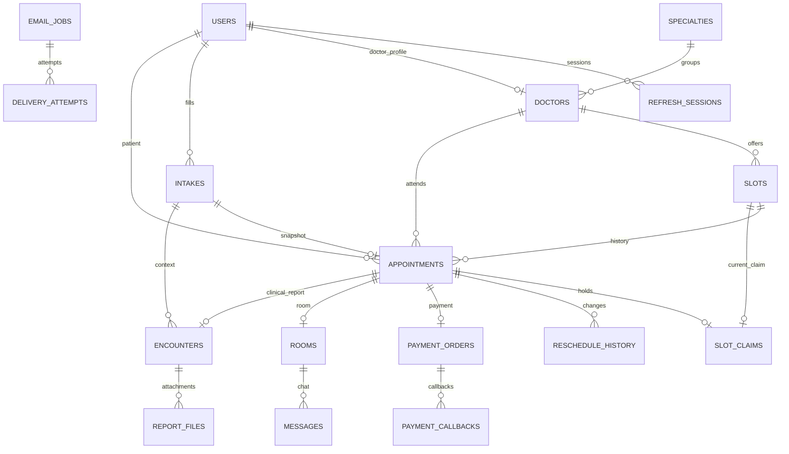

# THIẾT KẾ DATABASE TELEHEALTH — BẢN 1.0 ĐỀ XUẤT

Ngày 14/10/2026. Tham chiếu yêu cầu nghiệp vụ 1.0 và THIET_KE_KIEN_TRUC.md. Chưa tạo database trên VPS.

## 1. Tổ chức lưu trữ

Một PostgreSQL instance phục vụ môi trường local/container, chứa 6 database độc lập với 6 database user riêng biệt:
- `identity_db` (user: `identity_user`)
- `appointment_db` (user: `appointment_user`)
- `clinical_db` (user: `clinical_user`)
- `billing_db` (user: `billing_user`)
- `realtime_db` (user: `realtime_user`)
- `notification_db` (user: `notification_user`)

Mỗi service sở hữu trọn vẹn database của mình, quản lý schema thông qua Flyway migration riêng (`src/main/resources/db/migration/V1__initial_schema.sql` trong từng service module).

Tuyệt đối không có Foreign Key, Join hay truy vấn SQL xuyên qua database khác. Các liên kết giữa các bảng khác database (như `patient_id`, `doctor_id`, `appointment_id`, `intake_id`) là tham chiếu logic dạng UUID, được xác thực thông qua API và message events giữa các service.

File `DATABASE_SCHEMA.sql` ở thư mục gốc được giữ lại như bản đặc tả DDL tổng thể để đối chiếu kiến trúc, trong khi mã nguồn thực thi thực tế phân tách thành từng script Flyway độc lập cho từng microservice.

## 2. Sơ đồ quan hệ nghiệp vụ



Quan hệ với USERS, APPOINTMENTS giữa database là logic. Doctor có doctor_id cho hồ sơ và user_id cho đăng nhập; phòng phải giữ cả hai để kiểm tra sender đúng tài khoản bác sĩ.

## 3. Bảng theo service

| Database | Bảng | Ý nghĩa |
|---|---|---|
| identity | users | Email, hash mật khẩu, tên hiển thị, một vai trò/tài khoản, trạng thái |
| identity | refresh_sessions | Hash refresh token, hạn và thời điểm thu hồi |
| appointment | specialties, doctors | Chuyên khoa và hồ sơ bác sĩ |
| appointment | slots | Giờ bắt đầu ca, không có thời lượng tối đa |
| appointment | appointments | Lịch bệnh nhân, form tham chiếu, phí snapshot, trạng thái, deadline |
| appointment | slot_claims | Quyền giữ/đặt hiện hành trên ca |
| appointment | reschedule_history | Ca cũ/mới, giờ cũ/mới, người đổi và phiên bản |
| appointment | idempotency_requests | Tránh tạo nhiều lịch khi bấm lại hoặc request retry |
| clinical | intakes | Nội dung form mã hóa và trạng thái nháp/đã chốt |
| clinical | encounters | Hồ sơ báo cáo cho một lần khám |
| clinical | report_files | Metadata và vị trí file mã hóa; không lưu file lớn trong DB |
| clinical | audit_logs | Ai xem/sửa/tải dữ liệu nào, kết quả và thời điểm |
| billing | payment_orders | Mã thanh toán, số tiền, hạn, trạng thái và giao dịch provider |
| billing | payment_callbacks | Dấu vết callback được kiểm tra, chống xử lý lặp |
| realtime | rooms | Hai người tham gia, giờ hẹn, phiên bản vé, trạng thái phòng |
| realtime | messages | Tin nhắn mã hóa, ID client chống trùng, cursor lịch sử |
| notification | email_jobs | Email cần gửi, snapshot nội dung, trạng thái/retry |
| notification | delivery_attempts | Lịch sử từng lần gửi |
| Mỗi database | outbox_events, inbox_events | Phát sự kiện cùng transaction và chống xử lý lặp |

Các cột, kiểu dữ liệu, NOT NULL, FK, UNIQUE, CHECK và index xem đầy đủ trong DATABASE_SCHEMA.sql.

## 4. Cấu trúc biểu mẫu

intakes.payload_ciphertext chứa JSON sau khi mã hóa AES-256-GCM, gồm:

```json
{
  "reason": "Lý do khám",
  "symptoms": "Triệu chứng hiện tại",
  "medicalHistory": "Tiền sử bệnh hoặc không có/không rõ",
  "underlyingConditions": "Bệnh nền hoặc không có/không rõ",
  "symptomStartedAt": null,
  "currentMedications": "",
  "drugAllergies": ""
}
```

Ba trường cuối là bổ sung đề xuất. Không dùng các trường này để tìm kiếm trong phiên bản đầu. Ciphertext kèm authentication tag; nonce 12 byte phải mới cho mỗi lần mã hóa với cùng khóa. key_id là tên phiên bản khóa, không phải khóa giải mã; khóa nằm ngoài DB. Chat và báo cáo cũng có metadata mã hóa.

Form DRAFT được sửa. Khi chọn ca, Clinical tạo snapshot SUBMITTED có ID mới từ draft; Appointment tham chiếu snapshot đó. Nếu booking thất bại có thể retry snapshot, nhưng không gắn một snapshot cho hai lịch (UNIQUE intake_id). Khi lịch hết hạn và đặt mới, tạo snapshot mới từ draft; không sửa dữ liệu của lần đặt cũ. Clinical không lưu appointment_id trên intake để tránh hai chiều sở hữu; encounter giữ liên kết khi lập hồ sơ lần khám.

## 5. Cơ chế chống trùng và hết hạn

- slots UNIQUE(doctor_id, starts_at): không tạo hai ca cùng giờ cho một bác sĩ.
- appointments có FK composite(slot_id, doctor_id): lịch luôn thuộc bác sĩ của ca.
- slot_claims có slot_id PRIMARY KEY: một ca chỉ có một quyền giữ hiện hành.
- UNIQUE partial appointments(slot_id) WHERE status <> EXPIRED: lớp bảo vệ bổ sung cho lịch còn hiệu lực.
- Không dùng now() trong predicate index hoặc CHECK để tự động hết hạn. Worker/API phải chuyển pending quá hạn thành EXPIRED và xóa claim trong transaction.
- expires_at = created_at + 7 phút được CHECK tại DB. Khi tạo mã thanh toán, Billing sao chép cùng deadline; không cộng thêm 7 phút lần nữa.
- Khi xác nhận: status → CONFIRMED, confirmed_at có giá trị, claim HOLD → BOOKED và expires_at của claim → NULL. Giữ expires_at gốc trên appointment để tra lịch sử.
- Khi hoàn tất vẫn giữ claim BOOKED và lịch COMPLETED; ca đã sử dụng không được bán lại.
- UNIQUE partial doctor_id WHERE status=IN_PROGRESS: một bác sĩ chỉ khám một ca đang diễn ra.

Đổi lịch khóa appointment và các slot liên quan theo thứ tự nhất quán, kiểm tra giờ/ngày Việt Nam, chuyển claim, cập nhật slot và history/outbox trong cùng transaction. FK claim composite được deferred để cho phép cập nhật appointment và claim trong cùng transaction; commit phải khớp. Thất bại rollback nên ca cũ không mất.

## 6. Quy tắc nằm ở ứng dụng, không chỉ DDL

1. Bệnh nhân của form, lịch, payment và encounter phải khớp; tham chiếu liên service kiểm tra qua API có xác thực.
2. Không đổi doctor_id của lịch; chỉ đổi ca cùng bác sĩ.
3. Chỉ đổi CONFIRMED trước ngày khám và sang ngày sau hôm nay, không giới hạn số lần/phí.
4. Chuyển trạng thái hợp lệ: PENDING_PAYMENT → CONFIRMED hoặc EXPIRED; CONFIRMED → IN_PROGRESS → COMPLETED. Không có CANCELLED.
5. Hoàn tất cần báo cáo PUBLISHED có ít nhất một file READY. CHECK không kiểm tra được trạng thái bảng ở database khác.
6. Message sender phải là patient_id hoặc doctor_user_id của phòng; chat chỉ ghi khi ca cho phép.
7. Không chỉnh giờ/bác sĩ của slot đã có lịch có hiệu lực. Lưu giờ cũ/mới snapshot trong history để email không sai.
8. Khi đăng ký chuẩn hóa email; mật khẩu hash, token chỉ lưu hash. Không log payload nhạy cảm.
9. updated_at, tăng version và kiểm tra request_hash cho idempotency do service chịu trách nhiệm.
10. Outbox/inbox insert cùng transaction dữ liệu; retry không lặp thay đổi nghiệp vụ. Email SMTP vẫn có khả năng trùng nếu chết sau khi provider nhận nhưng trước ghi SENT.

## 7. Ví dụ xuyên suốt

Form được điền trước → tạo snapshot intake → appointment PENDING_PAYMENT lúc 10:00, expires_at 10:07 và claim HOLD → payment_order PENDING cùng hạn → thanh toán thành công → appointment CONFIRMED + claim BOOKED + email job.

Đổi từ ca A sang B: appointment giữ nguyên ID/doctor/payment/intake, cập nhật slot_id; claim chuyển sang B; history có A/B và email mới. Ca A trống trở lại.

Đến buổi khám: appointment IN_PROGRESS → chat trong room → bác sĩ tải report_files READY → encounter PUBLISHED → appointment COMPLETED. Bệnh nhân xem lại lịch sử và tải tài liệu, không có bảng bệnh/thuốc có cấu trúc.

## 8. Kiểm chứng và giới hạn

SQL là DDL thiết kế, chưa chạy trên PostgreSQL và chưa chứa grants, triggers, migration rollback hoặc seed. Không áp dụng thẳng lên VPS. Kiểm thử tiếp theo cần DB dùng một lần để kiểm tra FK/index, hai booking cùng ca, đổi lịch rollback, deadline và duplicate callback. Không cần truy cập máy chủ hiện có để duyệt mô hình.

Nguồn kỹ thuật: [PostgreSQL Constraints](https://www.postgresql.org/docs/current/ddl-constraints.html), [Date/time types](https://www.postgresql.org/docs/current/datatype-datetime.html).
