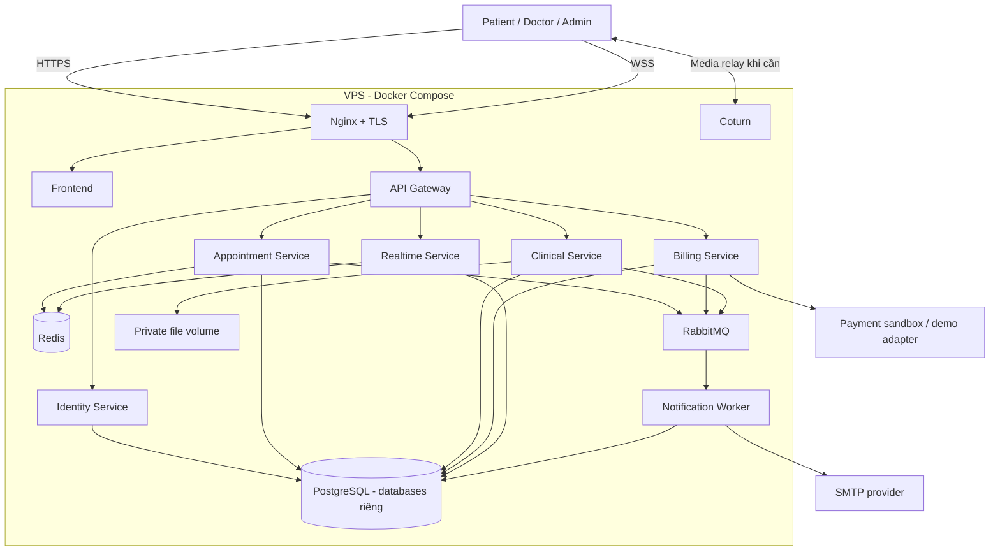
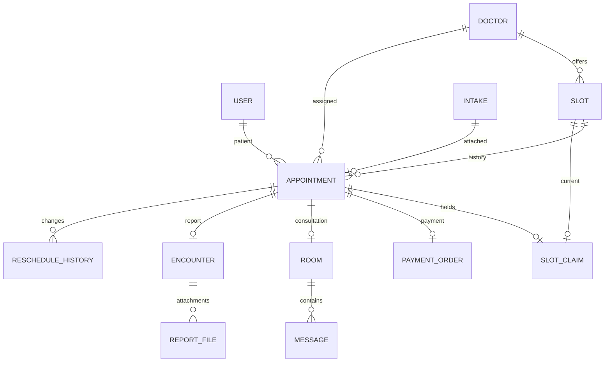
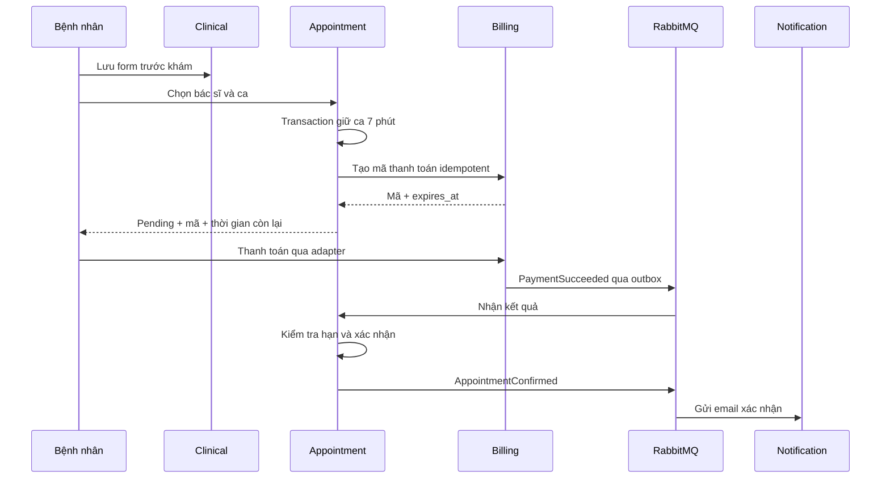

# THIẾT KẾ KIẾN TRÚC VÀ MÔ HÌNH ỨNG DỤNG

Ngày: 14/10/2026. Cơ sở: yêu cầu nghiệp vụ 1.0. Trạng thái: thiết kế đề xuất, chưa triển khai hoặc kết nối VPS.

## 1. Quyết định thiết kế

- **Kiến trúc:** Microservices theo chuẩn Java 17 và Spring Boot, quản lý bằng Gradle multi-project / wrapper, triển khai bằng Docker Compose.
- **Dịch vụ (Services):**
  1. `api-gateway`: Spring Cloud Gateway, định tuyến và kiểm tra JWT token, không có database.
  2. `identity-service`: Quản lý người dùng, vai trò (PATIENT, DOCTOR, ADMIN), phiên đăng nhập, JWT & BCrypt. Database riêng: `identity_db`.
  3. `appointment-service`: Quản lý chuyên khoa, bác sĩ, ca khám (slots), đặt lịch (giữ chỗ 7 phút nguyên tử), đổi ca, hoàn tất. Database riêng: `appointment_db`, Redis, RabbitMQ.
  4. `clinical-service`: Biểu mẫu trước khám (mã hóa AES-256-GCM), hồ sơ khám (encounters), lưu trữ và kiểm soát file báo cáo (Word/PDF/ZIP private volume). Database riêng: `clinical_db`.
  5. `billing-service`: Quản lý mã thanh toán mô phỏng (mock payment), đảm bảo idempotency, phát sự kiện thanh toán. Database riêng: `billing_db`.
  6. `realtime-service`: Phòng khám trực tuyến, cấp vé vào phòng, WebSocket chat (mã hóa, chống trùng, lưu lịch sử) và WebRTC signaling 1-1. Database riêng: `realtime_db`, Redis.
  7. `notification-service`: Lắng nghe sự kiện qua RabbitMQ, quản lý email jobs, gửi email qua Spring Mail (Mailpit ở local, SMTP ở production). Database riêng: `notification_db`.
- **Frontend:** React + TypeScript + Vite, giao diện tiếng Việt hoàn chỉnh, hợp nhất cả 3 vai trò (Bệnh nhân, Bác sĩ, Admin) trong một web app duy nhất.
- **Cơ sở dữ liệu:** PostgreSQL 16+ chứa 6 database độc lập với 6 user riêng biệt (`identity_user`, `appointment_user`, `clinical_user`, `billing_user`, `realtime_user`, `notification_user`). Tuyệt đối không có Foreign Key, Join hay truy vấn chéo giữa các database.
- **Giao tiếp liên dịch vụ:**
  - Đồng bộ: REST API nội bộ có xác thực Service Token / Internal Secret, timeout và xử lý lỗi.
  - Bất đồng bộ: RabbitMQ kết hợp Transactional Outbox Pattern và Consumer Inbox/Idempotency.
- **Thanh toán:** Mô phỏng hoàn toàn (Mock Payment) cho mục đích đồ án/demo, hiển thị mã thanh toán, thời gian đếm ngược 7 phút, nút thanh toán demo idempotent.
- **Email:** Hỗ trợ SMTP thật; môi trường local sử dụng Mailpit (SMTP port 1025, Web UI port 8025) để xem email thử nghiệm.
- **WebRTC & Media:** Trực tiếp P2P qua trình duyệt, tích hợp Coturn container cho STUN/TURN relay khi NAT đối xứng.

## 2. Sơ đồ triển khai



Media trực tiếp giữa hai trình duyệt khi có thể; Coturn relay khi cần. Signaling không vận chuyển âm thanh/video.

### Mạng và volume

- Nginx công khai 80/443; TURN công khai 3478 UDP/TCP, 5349 cho TLS nếu cấu hình và dải UDP relay được chọn. SSH phục vụ quản trị. Kiểm tra firewall VPS và nhà cung cấp trước triển khai.
- Backend và Gateway không publish port ra host. Nginx truy cập Gateway qua mạng Docker.
- Database, Redis, RabbitMQ không công khai. Tách mạng edge, service và data theo quyền truy cập. Service gửi SMTP/thanh toán phải có đường egress; không đặt mọi container vào mạng không có Internet.
- Volumes: PostgreSQL, RabbitMQ, file báo cáo, chứng chỉ. Redis không giữ dữ liệu nghiệp vụ duy nhất.
- Không đặt báo cáo dưới thư mục static của Nginx. Không công khai trang quản trị RabbitMQ.
- Coturn dùng cấu hình public IP/NAT đúng thực tế, credential ngắn hạn và quota; dải relay chốt sau khảo sát.

## 3. Ranh giới service

| Service | Sở hữu | Trách nhiệm |
|---|---|---|
| Identity | users, refresh_sessions | Đăng nhập, tài khoản, vai trò, thông tin liên hệ |
| Appointment | doctors, specialties, slots, appointments, slot_claims, reschedule_history | Danh mục bác sĩ, giờ bắt đầu ca, giữ ca, xác nhận, đổi lịch, trạng thái buổi khám |
| Clinical | intakes, encounters, report_files, audit_logs | Form trước khám, hồ sơ lần khám, file báo cáo, quyền truy cập dữ liệu y tế |
| Billing | payment_orders, payment_callbacks | Mã thanh toán, trạng thái giao dịch, adapter demo/sandbox |
| Realtime | rooms, messages | Phòng, chat lưu lịch sử, signaling, presence, vé vào phòng |
| Notification | email_jobs, delivery_attempts | Email xác nhận đặt/đổi lịch, retry, theo dõi gửi |

Mỗi producer có outbox; consumer có inbox/deduplication theo event_id. Admin được quản lý tài khoản và lịch nhưng không mặc định đọc bệnh án/file; quyền đó cần thiết kế riêng.

Gateway kiểm tra token và định tuyến. Các service vẫn kiểm tra quyền trên tài nguyên; internal API dùng thông tin xác thực service, không tin header vai trò từ trình duyệt.

## 4. Mô hình dữ liệu

ID dùng UUID; thời gian lưu UTC dạng timestamptz, ngày nghiệp vụ tính theo Asia/Ho_Chi_Minh. Tiền lưu số nguyên VNĐ. Các ID liên service là tham chiếu logic và được kiểm tra qua API/sự kiện.

| Thực thể | Trường quan trọng |
|---|---|
| users | id, email unique, password_hash, role, display_name, status |
| doctors | id, user_id unique, specialty_id, display_name, bio, active |
| slots | id, doctor_id, starts_at, enabled; unique(doctor_id, starts_at) |
| appointments | id, patient_id, doctor_id, slot_id, intake_id, status, expires_at, amount_vnd, version, started_at, completed_at |
| slot_claims | slot_id primary key, appointment_id unique, kind HOLD/BOOKED, expires_at nullable |
| reschedule_history | id, appointment_id, old_slot_id, new_slot_id, changed_at, actor_id |
| intakes | id, patient_id, appointment_id nullable unique, encrypted_payload, state DRAFT/SUBMITTED, created_at |
| encounters | id, appointment_id unique, patient_id, doctor_id, state DRAFT/PUBLISHED, published_at |
| report_files | id, encounter_id, storage_key, original_name, mime_type, size_bytes, checksum, uploaded_by |
| payment_orders | id, appointment_id unique, amount_vnd, status, payment_code, expires_at, provider_transaction_id |
| rooms | id, appointment_id unique, patient_id, doctor_id, state, admission_version |
| messages | id, room_id, sender_id, client_message_id, body, created_at; unique(room_id, sender_id, client_message_id) |
| email_jobs | id, event_id, recipient, template, payload, status, attempts, next_attempt_at; unique(event_id, recipient, template) |
| audit_logs | id, actor_id, action, resource_id, result, created_at; không chứa nội dung y tế |
| outbox / inbox | event_id, type, aggregate_id, version, payload, processed_at |



ER thể hiện quan hệ nghiệp vụ; chỉ quan hệ trong cùng database mới có foreign key SQL.

## 5. Đặt ca và thanh toán 7 phút

1. Clinical lưu form DRAFT trước khi chọn bác sĩ. Khi đặt, Appointment kiểm tra form thuộc bệnh nhân, chốt snapshot bất biến theo intake_id; thao tác này có thể retry. Nếu đặt thất bại, snapshot vẫn có thể dùng lại cho lần đặt tiếp theo, không sinh lịch ngoài ý muốn.
2. Request đặt ca có Idempotency-Key. Appointment khóa row slot trong transaction, xử lý claim đã hết hạn nếu có, tạo appointment và slot_claim HOLD. expires_at = thời điểm server + 7 phút; lưu outbox AppointmentHeld cùng transaction.
3. Billing tạo payment_order qua internal API idempotent, cùng expires_at của appointment. API trả mã và expires_at cho frontend. Nếu Billing tạm lỗi, giữ nguyên thời hạn và cho tải lại thông tin; không reset 7 phút. Mã không tạo được thì báo lỗi rõ, không hiện mã giả thành giao dịch thật.
4. Billing adapter nhận xác nhận hợp lệ, lưu PAID và PaymentSucceeded trong cùng transaction; chỉ môi trường demo mới có endpoint mô phỏng thanh toán, tắt ở production.
5. Appointment nhận sự kiện, khóa appointment và slot theo thứ tự cố định, kiểm tra trạng thái và thời hạn, chuyển CONFIRMED, claim BOOKED, tạo AppointmentConfirmed trong outbox. Frontend hiển thị đã xác nhận khi Appointment đã xác nhận, không dựa vào trang redirect thanh toán.
6. Worker expiry quét định kỳ các HOLD hết hạn. API chọn ca cũng dọn claim hết hạn dưới khóa row; không phụ thuộc Redis TTL hay việc frontend còn mở.
7. Retry/duplicate không tạo lịch, khoản thanh toán hoặc xác nhận mới. Saga tối giản: giữ ca → tạo thanh toán → xác nhận; hết hạn là hành động bù giải phóng ca.

Thanh toán/notification tới sau khi lịch đã hết hạn không được khôi phục hoặc chiếm ca của người khác. Ghi nhận ngoại lệ để kiểm tra; tự động hoàn tiền/đối soát thanh toán muộn ngoài phạm vi. Ngay cả khi provider xác nhận sát hạn, sự kiện có thể đến trễ; demo chọn thời điểm thanh toán đủ xa mốc hết hạn. Đây là giới hạn có chủ đích, không tuyên bố hỗ trợ thanh toán thật đầy đủ.



Khóa chỉ kéo dài trong transaction ngắn; không giữ database lock 7 phút. Claim là bản ghi nghiệp vụ lâu dài. Cơ chế khóa row theo tài liệu PostgreSQL: https://www.postgresql.org/docs/17/explicit-locking.html

## 6. Đổi ca

- Chỉ CONFIRMED, ngày hiện tại ở Việt Nam phải nhỏ hơn ngày lịch hiện tại. Ca mới cùng doctor_id, còn trống, ở ngày sau hôm nay. Không phí/giới hạn số lần.
- Khóa appointment rồi các slot liên quan theo thứ tự ID cố định; mọi đường code áp dụng cùng quy tắc khóa.
- Trong một transaction: kiểm tra ca mới, chuyển claim từ ca cũ sang ca mới, cập nhật slot_id/version, ghi history và outbox AppointmentRescheduled. Nếu lỗi rollback toàn bộ.
- payment_order và intake không đổi. Email lấy thời gian cũ/mới từ snapshot event, không đọc lịch hiện tại để tạo nội dung sự kiện cũ.
- Giữ room_id; tăng admission_version và bỏ hiệu lực vé phòng cũ. Realtime kiểm tra lịch hiện hành khi vào phòng.

## 7. Khám không giới hạn thời lượng

Đề xuất giờ bắt đầu cách nhau 30 phút, cấu hình được; đây là khoảng bố trí lịch, không phải hạn cuộc gọi. Bác sĩ không tự động bị ngắt khi đến ca kế tiếp.

- Bệnh nhân có thể vào phòng chờ từ 10 phút trước giờ hẹn (mặc định thiết kế, cấu hình được).
- Bác sĩ bấm Bắt đầu khám; Appointment chuyển IN_PROGRESS và khóa hoạt động theo doctor_id để chỉ có một ca đang khám của bác sĩ.
- Ca tiếp theo hiển thị bác sĩ đang khám và chờ bác sĩ bắt đầu. Không tự đổi giờ hẹn hoặc tạo quy trình xử lý vắng mặt.
- Kết thúc cuộc gọi không hoàn tất lịch; phòng cho phép kết nối lại trong IN_PROGRESS.
- Bác sĩ tải báo cáo, bấm hoàn tất. Clinical publish encounter và phát EncounterPublished; Appointment chuyển COMPLETED, Realtime đóng quyền gọi mới. Nếu event bị trễ, giao diện hiển thị đang hoàn tất và retry; không làm mất file đã publish.
- Sau COMPLETED, đề xuất chat chỉ đọc và báo cáo không sửa; cần sửa thì thiết kế version sau, không ghi đè im lặng.

## 8. Chat, video và file

- Vé vào phòng có hạn ngắn, participant IDs, room_id và admission_version. Kiểm tra JWT, quyền lịch hiện tại ở handshake/join; không đưa token dài hạn vào URL.
- Một kết nối media hoạt động cho mỗi người trong phòng; reconnect thay phiên cũ. Presence nằm Redis với TTL, không suy ra hoàn tất lịch từ việc offline.
- Tin nhắn lưu DB rồi xác nhận cho người gửi/broadcast; reconnect tải từ cursor. client_message_id tránh gửi trùng. Signaling chỉ chuyển offer/answer/ICE đến đúng người còn lại.
- TURN credential cấp ngắn hạn và làm mới khi cần cho ca kéo dài. Phân biệt hạn credential với giới hạn cuộc khám.
- Upload file ở trạng thái tạm; kiểm tra định dạng/size, lưu bằng key do server tạo. Đề xuất DOCX/PDF/ZIP, tổng 20 MB/lần báo cáo, cho nhiều file. Folder zip trước khi tải lên, không giải nén ZIP trên server.
- Không dùng đường dẫn/tên do người dùng cung cấp làm đường dẫn lưu trữ. File ready trước khi publish metadata; dọn orphan định kỳ nếu lưu file thành công nhưng DB lỗi.
- Tải qua API kiểm tra quyền, trả attachment; mã hóa file và payload form khi lưu, quản lý khóa riêng ngoài database. Bệnh nhân chỉ tải bản PUBLISHED của mình.

## 9. API chính

Tất cả đường dẫn có prefix /api/v1. Danh sách là hợp đồng sơ bộ, chưa phải OpenAPI cuối.

| API | Service | Quyền |
|---|---|---|
| POST /auth/login, /auth/refresh, /auth/logout | Identity | Người dùng |
| GET /doctors; GET /doctors/:id/slots | Appointment | Người dùng |
| POST /intakes; PATCH /intakes/:id | Clinical | Chủ form, chỉ DRAFT |
| POST /appointments | Appointment | Patient + Idempotency-Key |
| GET /appointments; GET /appointments/:id | Appointment | Chủ lịch / bác sĩ được phân công |
| POST /appointments/:id/reschedule | Appointment | Chủ lịch |
| GET /appointments/:id/payment | Billing | Chủ lịch |
| POST /payments/webhook | Billing | Provider signature, không dùng quyền bệnh nhân |
| POST /appointments/:id/start | Appointment | Bác sĩ của lịch |
| POST /rooms/:id/join | Realtime | Thành viên có quyền hiện tại |
| GET /rooms/:id/messages | Realtime | Thành viên của ca |
| POST /encounters/:id/files | Clinical | Bác sĩ của lịch |
| POST /encounters/:id/publish | Clinical | Bác sĩ, có file ready |
| GET /reports/:id/files/:fileId/download | Clinical | Bác sĩ / bệnh nhân được phép |
| GET/POST /admin/doctors, /admin/slots | Appointment | Admin |

## 10. Sự kiện và độ tin cậy

Sự kiện: AppointmentHeld, PaymentSucceeded, AppointmentConfirmed, AppointmentExpired, AppointmentRescheduled, ConsultationStarted, EncounterPublished, AppointmentCompleted.

Envelope: event_id, type, schema_version, aggregate_id, aggregate_version, occurred_at, correlation_id, payload. Không đưa nội dung biểu mẫu, chat hoặc báo cáo vào broker; chỉ ID và snapshot thời gian phục vụ email.

- Outbox ghi cùng transaction dữ liệu; relay gửi với publisher confirms. Consumer ack sau transaction, dedup event_id, retry có backoff và đưa lỗi dai dẳng vào dead-letter queue.
- Consumer projection kiểm tra version, không để sự kiện cũ ghi đè lịch mới; đọc lại owner service nếu có khoảng trống version.
- Không cam kết exactly-once. Email thông thường có thể gửi trùng nếu provider đã nhận nhưng worker chết trước khi ghi SENT; dùng provider idempotency nếu có, nếu không ghi nhận giới hạn này.
- Clinical/Realtime projection là bản hỗ trợ; kiểm tra quyền quan trọng dựa vào owner hoặc admission version hiện hành.

Nguồn: [Transactional Outbox](https://microservices.io/patterns/data/transactional-outbox.html), [RabbitMQ acknowledgements và confirms](https://www.rabbitmq.com/docs/confirms).

## 11. Mô hình màn hình

| Vai trò | Màn hình |
|---|---|
| Patient | Dashboard; Form trước khám; Chọn bác sĩ/ca; Thanh toán đếm ngược; Lịch của tôi; Đổi ca; Phòng chờ/chat/video; Chi tiết lần khám và tải báo cáo |
| Doctor | Lịch khám theo ngày; Chi tiết form bệnh nhân; Phòng khám; Upload tài liệu và hoàn tất; Lịch sử ca được phân công |
| Admin | Tài khoản; Bác sĩ/chuyên khoa; Tạo giờ bắt đầu ca; Theo dõi lịch/giao dịch/email lỗi; Audit metadata |

Đề xuất Admin tạo tài khoản bác sĩ và giờ ca; bệnh nhân đăng ký tài khoản. Không thêm màn hình kê đơn, kho thuốc hoặc nội trú.

## 12. Cấu trúc repository và triển khai

```text
apps/web
services/gateway
services/identity
services/appointment
services/clinical
services/billing
services/realtime
services/notification
packages/contracts
infra/compose
infra/nginx
infra/coturn
docs
```

packages/contracts chứa schema DTO/event, không chia sẻ ORM entity hoặc truy vấn database. Mỗi service có Dockerfile, health endpoint, migrations và cấu hình riêng.

Triển khai: build image có tag commit → backup trước migration ảnh hưởng dữ liệu → migration tương thích → docker compose cập nhật → kiểm tra health và luồng chính. Rollback image chỉ an toàn khi schema tương thích; không tự rollback dữ liệu.

Secrets không commit, mount file với quyền hạn chế. Pin phiên bản image. Cấu hình restart, healthcheck, log rotation và resource limit sau khi khảo sát VPS. Không coi depends_on là giải pháp retry khi database/broker lỗi trong lúc chạy.

Backup PostgreSQL + volume báo cáo + khóa mã hóa sang nơi ngoài VPS; kiểm tra restore. Theo dõi disk, memory, API errors, outbox backlog, email failures, TURN bandwidth. Chưa thiết kế HA; VPS là điểm lỗi chung.

## 13. Thứ tự xây dựng và kiểm chứng

1. Khung repository, Docker local, Identity và phân quyền.
2. Bác sĩ/ca, form, giữ chỗ cạnh tranh và expiry 7 phút.
3. Payment demo/sandbox, Saga và email xác nhận.
4. Đổi ca nguyên tử, khóa theo ngày Việt Nam, email giờ cũ/mới.
5. Phòng chat, vé tham gia, lưu lịch sử và reconnect.
6. WebRTC + Coturn; thử VPS trên hai mạng và ép relay.
7. Upload/publish/download báo cáo, hoàn tất ca và quyền dữ liệu.
8. Backup/restore, kiểm thử truy cập chéo, lỗi broker, callback lặp và hạn giữ ca.

Chưa xác nhận thông số VPS, domain, SMTP, payment provider. Mặc định 30 phút giữa giờ bắt đầu, mở phòng trước 10 phút, phí 100.000 VNĐ và file 20 MB là cấu hình đề xuất, không phải quy tắc đã chốt riêng. Thiết kế này không triển khai chức năng thanh toán muộn/hoàn tiền, no-show, nội trú hoặc kê đơn có cấu trúc.
